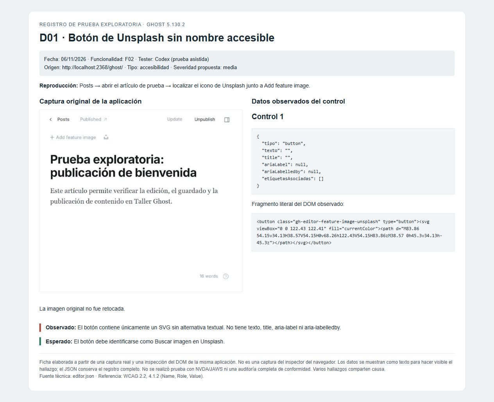
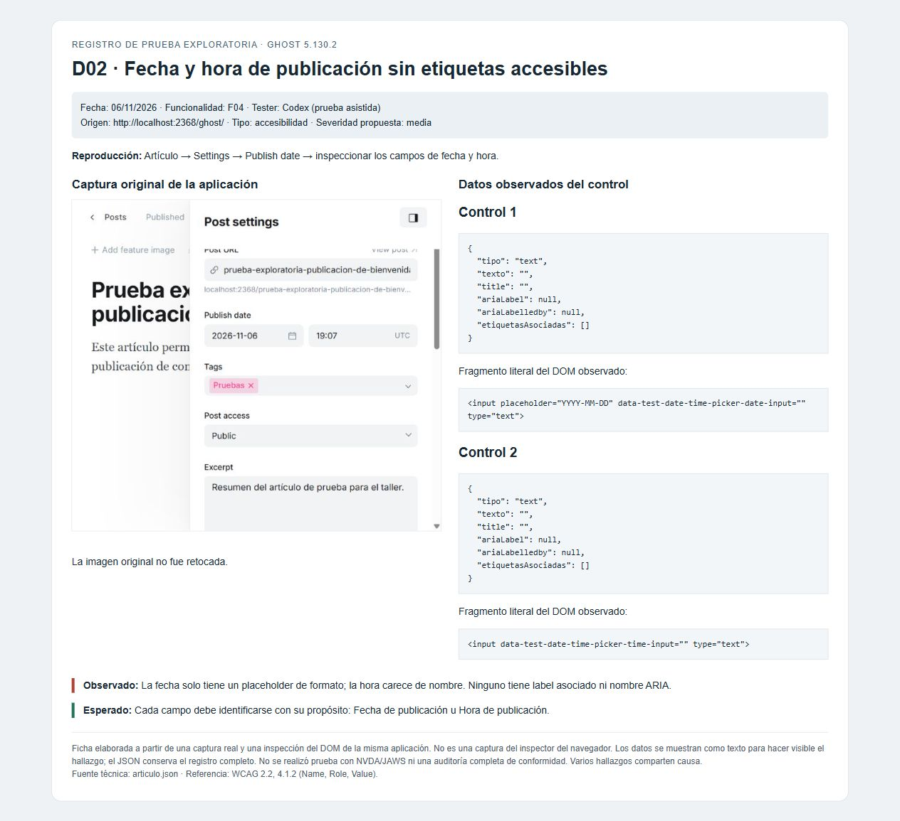
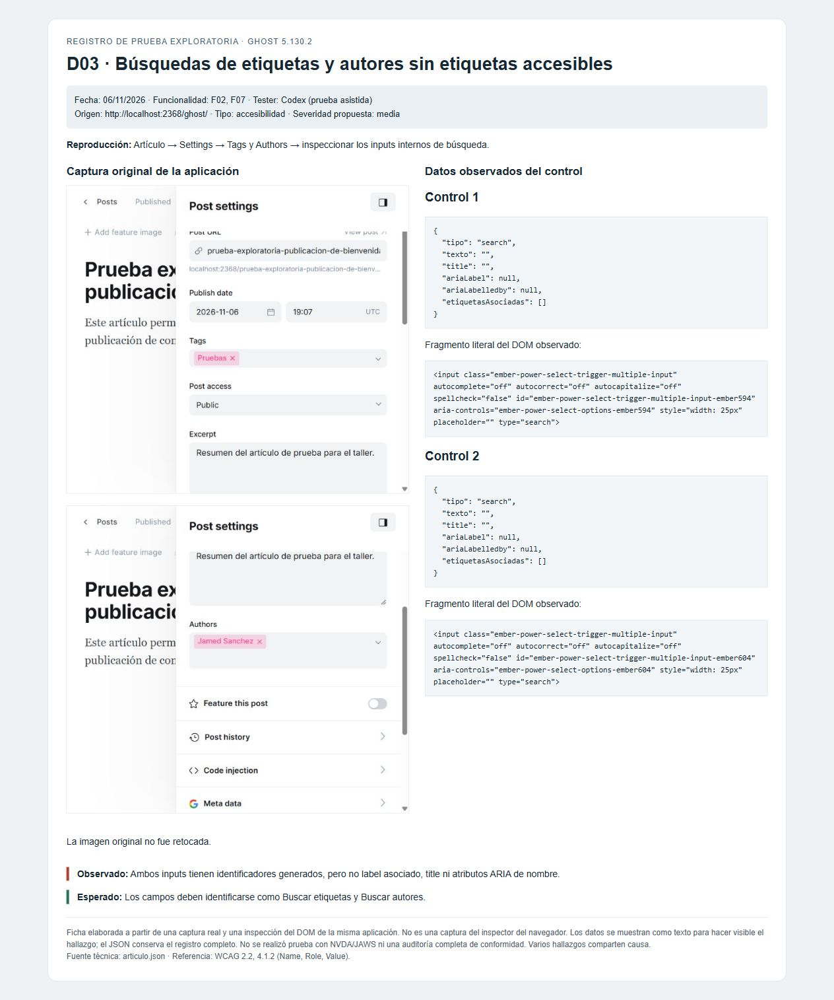
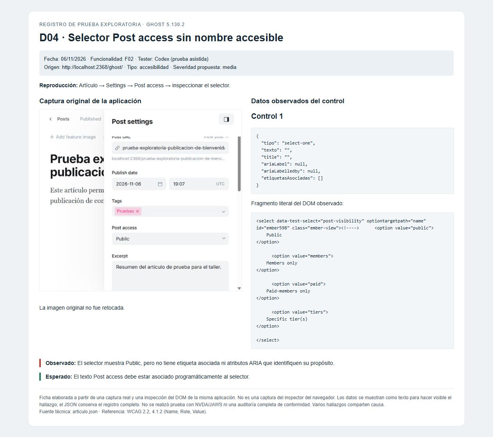
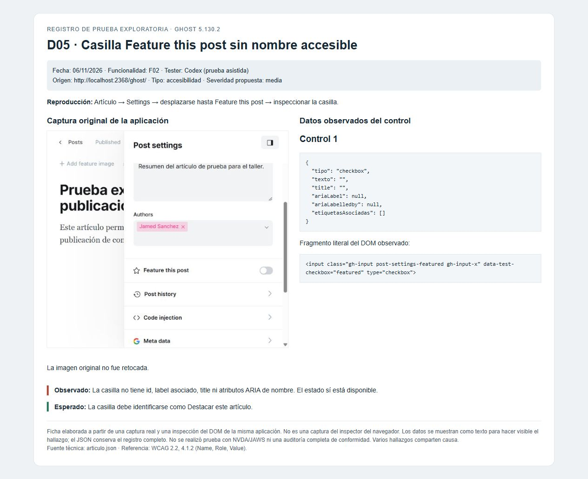
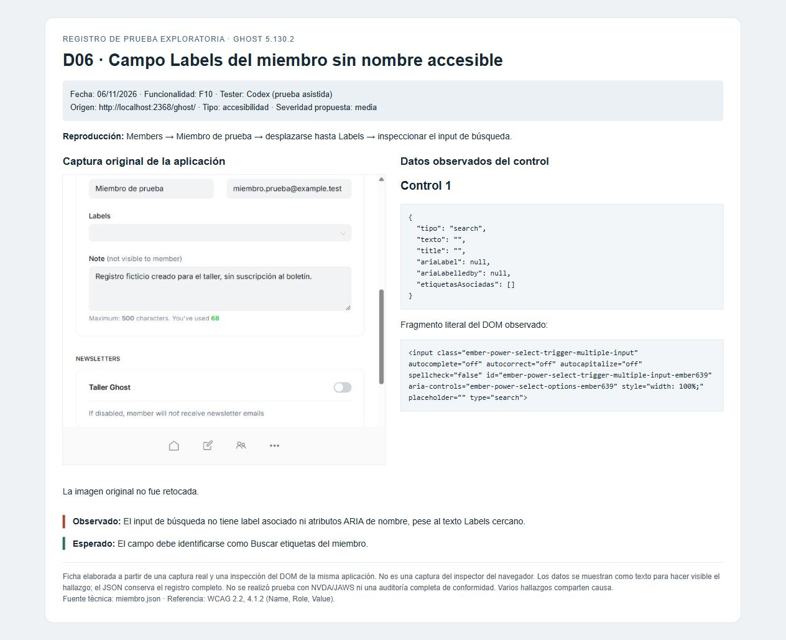
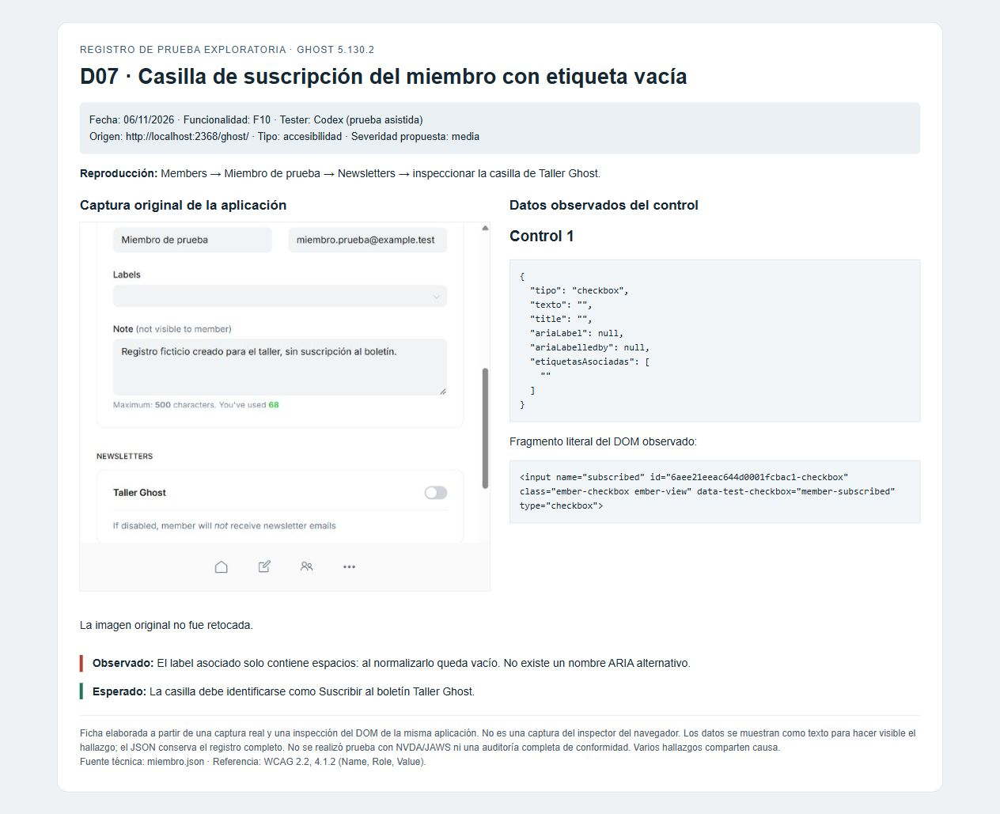
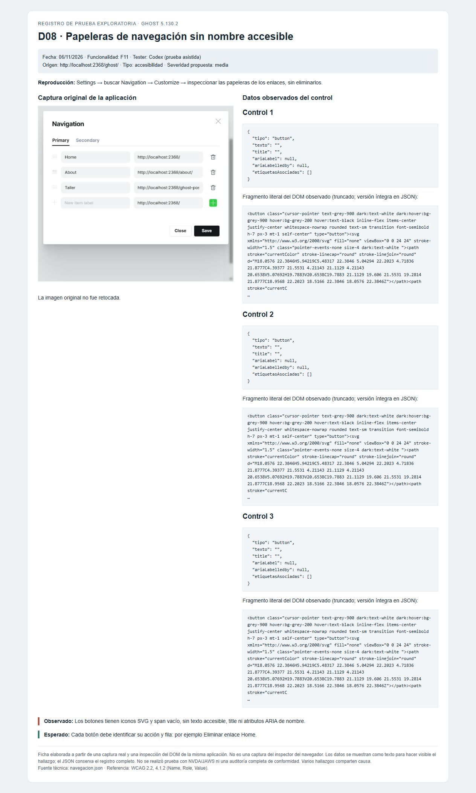
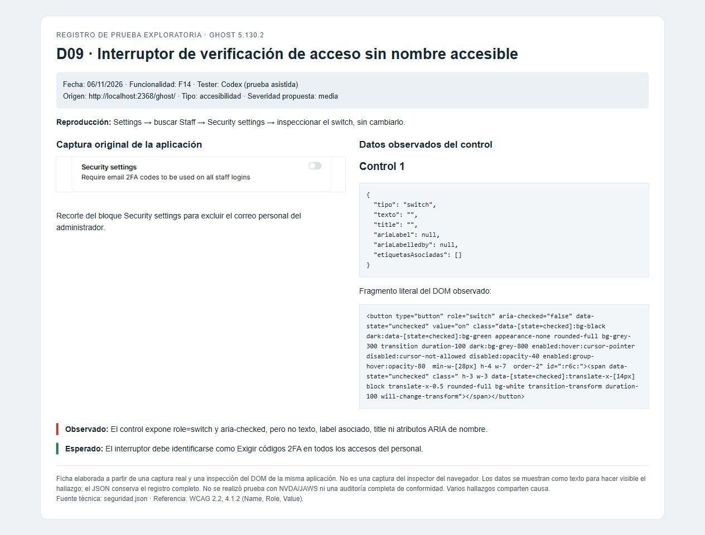
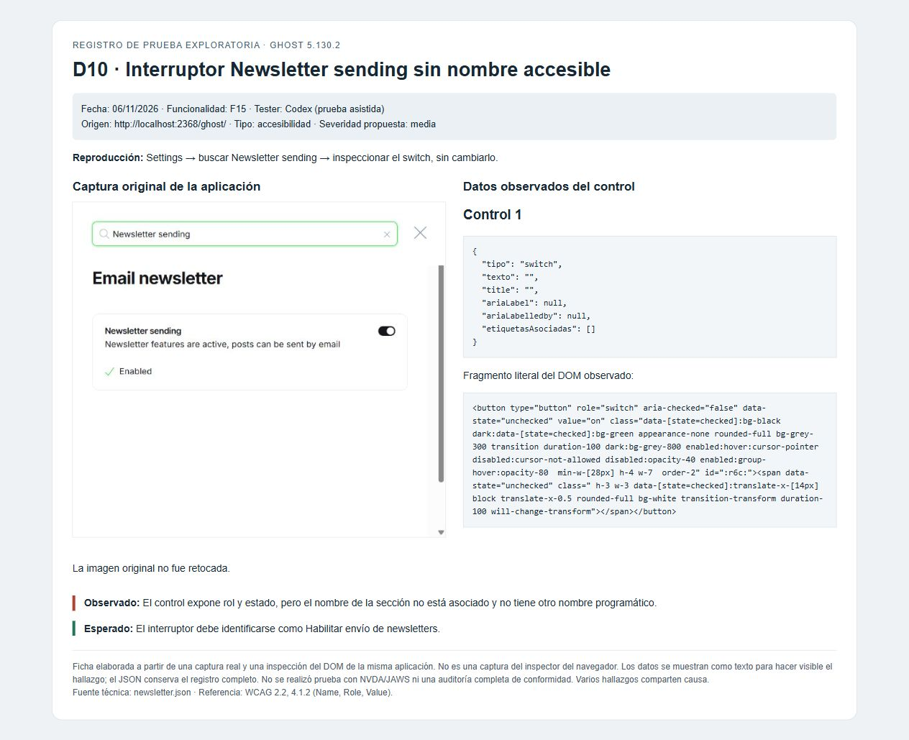

# Evidencias del taller Ghost 5.130.2

[**Tablas con el formato solicitado y diagrama de dominio**](formatos-diligenciados.md) · [Informe](informe-taller.md)

Fecha: 6 de noviembre de 2026. Tester: Codex (prueba asistida). Entorno: Ghost 5.130.2 en Docker, SQLite development, tema Source 1.5.0.

## Evidencias visuales por hallazgo

Cada enlace abre un PNG que reúne una captura original de Ghost y los atributos observados del control. Son fichas de evidencia elaboradas, identificadas como tales; no capturas del inspector del navegador. Se incluyen los originales y los JSON para revisar la procedencia.

| ID | Hallazgo | Screenshot | Fuente técnica |
|---|---|---|---|
| D01 | Botón de Unsplash sin nombre accesible | [Ver imagen](verificacion/D01.png) | [JSON](verificacion/editor.json) |
| D02 | Fecha y hora de publicación sin etiquetas accesibles | [Ver imagen](verificacion/D02.png) | [JSON](verificacion/articulo.json) |
| D03 | Búsquedas de etiquetas y autores sin etiquetas accesibles | [Ver imagen](verificacion/D03.png) | [JSON](verificacion/articulo.json) |
| D04 | Selector Post access sin nombre accesible | [Ver imagen](verificacion/D04.png) | [JSON](verificacion/articulo.json) |
| D05 | Casilla Feature this post sin nombre accesible | [Ver imagen](verificacion/D05.png) | [JSON](verificacion/articulo.json) |
| D06 | Campo Labels del miembro sin nombre accesible | [Ver imagen](verificacion/D06.png) | [JSON](verificacion/miembro.json) |
| D07 | Casilla de suscripción del miembro con etiqueta vacía | [Ver imagen](verificacion/D07.png) | [JSON](verificacion/miembro.json) |
| D08 | Papeleras de navegación sin nombre accesible | [Ver imagen](verificacion/D08.png) | [JSON](verificacion/navegacion.json) |
| D09 | Interruptor de verificación de acceso sin nombre accesible | [Ver imagen](verificacion/D09.png) | [JSON](verificacion/seguridad.json) |
| D10 | Interruptor Newsletter sending sin nombre accesible | [Ver imagen](verificacion/D10.png) | [JSON](verificacion/newsletter.json) |

Los diez registros son hallazgos de accesibilidad; varios comparten la causa de etiquetas no asociadas. No se afirman diez fallos funcionales independientes. Se usó inspección del DOM y árbol de accesibilidad; no se probó con NVDA/JAWS ni se realizó una auditoría completa de conformidad.

## Archivos originales

- [articulo-autores.png](verificacion/articulo-autores.png)
- [articulo-inferior.png](verificacion/articulo-inferior.png)
- [articulo-superior.png](verificacion/articulo-superior.png)
- [editor.png](verificacion/editor.png)
- [miembro.png](verificacion/miembro.png)
- [navegacion.png](verificacion/navegacion.png)
- [newsletter.png](verificacion/newsletter.png)
- [seguridad.png](verificacion/seguridad.png)

## Fichas completas

### D01

**Botón de Unsplash sin nombre accesible**

[Datos completos](verificacion/editor.json) · [HTML de la ficha](verificacion/D01.html)

### D02

**Fecha y hora de publicación sin etiquetas accesibles**

[Datos completos](verificacion/articulo.json) · [HTML de la ficha](verificacion/D02.html)

### D03

**Búsquedas de etiquetas y autores sin etiquetas accesibles**

[Datos completos](verificacion/articulo.json) · [HTML de la ficha](verificacion/D03.html)

### D04

**Selector Post access sin nombre accesible**

[Datos completos](verificacion/articulo.json) · [HTML de la ficha](verificacion/D04.html)

### D05

**Casilla Feature this post sin nombre accesible**

[Datos completos](verificacion/articulo.json) · [HTML de la ficha](verificacion/D05.html)

### D06

**Campo Labels del miembro sin nombre accesible**

[Datos completos](verificacion/miembro.json) · [HTML de la ficha](verificacion/D06.html)

### D07

**Casilla de suscripción del miembro con etiqueta vacía**

[Datos completos](verificacion/miembro.json) · [HTML de la ficha](verificacion/D07.html)

### D08

**Papeleras de navegación sin nombre accesible**

[Datos completos](verificacion/navegacion.json) · [HTML de la ficha](verificacion/D08.html)

### D09

**Interruptor de verificación de acceso sin nombre accesible**

[Datos completos](verificacion/seguridad.json) · [HTML de la ficha](verificacion/D09.html)

### D10

**Interruptor Newsletter sending sin nombre accesible**

[Datos completos](verificacion/newsletter.json) · [HTML de la ficha](verificacion/D10.html)

La captura de Security settings se recortó para excluir el correo personal del administrador. No se publican contraseñas, códigos de verificación ni la base de datos. La dirección del miembro ficticio usa example.test.
