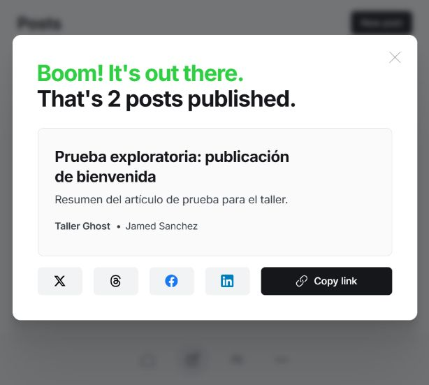
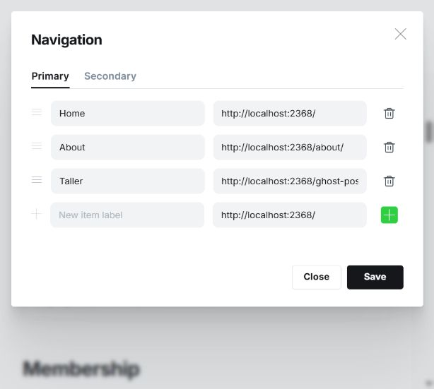

# Evidencias públicas — Taller Ghost 5.130.2

Pruebas del 6 de noviembre de 2026. Entorno local Docker y tema Source v1.5.0.

[Informe completo: funcionalidades, pasos de reproducción y diagrama de dominio](informe-taller.md).

Los 10 hallazgos corresponden a accesibilidad: varios comparten la ausencia de nombres programáticos. No son 10 fallos funcionales independientes. La validación usó DOM y árbol de accesibilidad; no se probó NVDA/JAWS. Las capturas muestran contexto, mientras los JSON sustentan los atributos de los controles.

## Capturas

- [01-publicacion.png](01-publicacion.png)
- [02-miembro.png](02-miembro.png)
- [04-navegacion.png](04-navegacion.png)
- [06-ajustes-articulo.png](06-ajustes-articulo.png)
- [07-busqueda.png](07-busqueda.png)
- [09-sitio-publico.png](09-sitio-publico.png)

## Evidencias por hallazgo

### D01

**Botón de Unsplash sin nombre accesible.**

[Consultar evidencia técnica](05-editor-controles.json). Los pasos y el resultado esperado están en la fila D01 del [informe](informe-taller.md).

### D02

**Fecha y hora de publicación sin identificación accesible.**

[Consultar evidencia técnica](06-ajustes-articulo.json). Los pasos y el resultado esperado están en la fila D02 del [informe](informe-taller.md).

### D03

**Búsquedas de etiquetas y autores sin etiqueta accesible.**

[Consultar evidencia técnica](06-ajustes-articulo.json). Los pasos y el resultado esperado están en la fila D03 del [informe](informe-taller.md).

### D04

**Selector Post access sin nombre accesible.**

[Consultar evidencia técnica](06-ajustes-articulo.json). Los pasos y el resultado esperado están en la fila D04 del [informe](informe-taller.md).

### D05

**Casilla Feature this post sin nombre accesible.**

[Consultar evidencia técnica](06-ajustes-articulo.json). Los pasos y el resultado esperado están en la fila D05 del [informe](informe-taller.md).

### D06

**Campo Labels del miembro sin nombre accesible.**

[Consultar evidencia técnica](08-miembro-controles.json). Los pasos y el resultado esperado están en la fila D06 del [informe](informe-taller.md).

### D07

**Casilla de suscripción del miembro con etiqueta vacía.**

[Consultar evidencia técnica](08-miembro-controles.json). Los pasos y el resultado esperado están en la fila D07 del [informe](informe-taller.md).

### D08

**Papeleras de navegación sin nombre accesible.**

[Consultar evidencia técnica](04-navegacion-controles.json). Los pasos y el resultado esperado están en la fila D08 del [informe](informe-taller.md).

### D09

**Interruptor de verificación de acceso sin nombre accesible.**

[Consultar evidencia técnica](03-ajustes-controles.json). Los pasos y el resultado esperado están en la fila D09 del [informe](informe-taller.md).

### D10

**Interruptor de newsletters sin nombre accesible.**

[Consultar evidencia técnica](03-ajustes-controles.json). Los pasos y el resultado esperado están en la fila D10 del [informe](informe-taller.md).

## Vista de la publicación

## Vista del menú de navegación

Las imágenes no contienen contraseñas ni códigos de verificación. El miembro mostrado usa una dirección ficticia example.test. No se publica la base de datos de Ghost ni sus registros privados.
