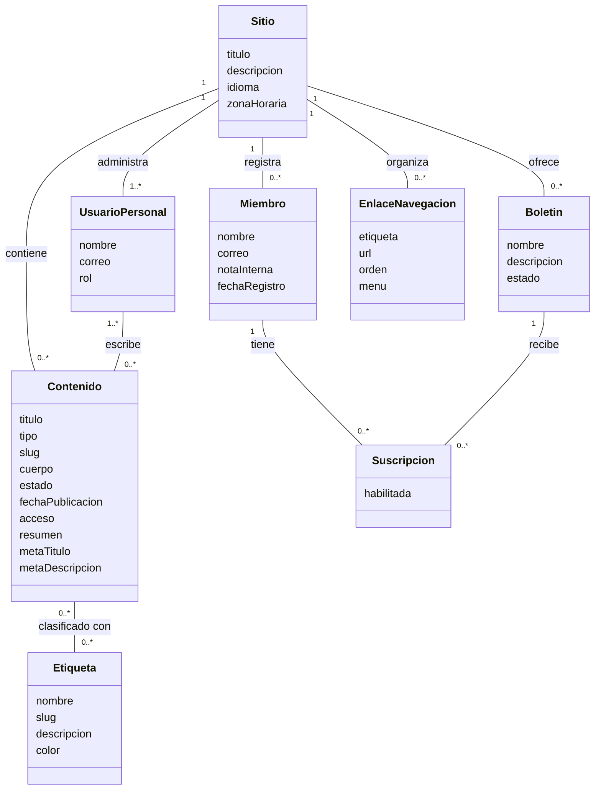

# Taller Ghost — formatos diligenciados

Fecha de pruebas y revalidación: 6 de noviembre de 2026. Ghost 5.130.2, Docker, SQLite development, tema Source 1.5.0. Tester: Codex (prueba asistida); el estudiante organiza y entrega el PDF.

## Funcionalidades

| ID | Funcionalidad | Descripción |
|---|---|---|
| F01 | Acceso administrativo | Permite ingresar con correo y contraseña, con verificación por correo cuando corresponde. |
| F02 | Edición de artículos | Permite crear y modificar título, contenido, autores y opciones del artículo. |
| F03 | Guardado automático de borradores | Conserva los cambios del contenido sin publicarlo. |
| F04 | Publicación de contenido | Permite publicar contenido y establecer su fecha y hora. |
| F05 | Previsualización | Permite abrir una vista previa del contenido antes de publicarlo. |
| F06 | Resumen y metadatos SEO | Permite definir resumen, título SEO y descripción para buscadores. |
| F07 | Clasificación de artículos | Permite asociar etiquetas para organizar artículos. |
| F08 | Administración de etiquetas | Permite crear y editar nombre, slug, descripción y color de etiquetas. |
| F09 | Administración de páginas | Permite crear, editar y publicar páginas estáticas. |
| F10 | Administración de miembros | Permite registrar miembros y gestionar datos, etiquetas, notas y suscripciones. |
| F11 | Configuración de navegación | Permite agregar y modificar enlaces de los menús. |
| F12 | Filtrado de publicaciones | Permite consultar publicaciones según su estado. |
| F13 | Búsqueda de contenido | Permite localizar artículos mediante palabras clave. |
| F14 | Configuración de seguridad del personal | Incluye la opción de exigir códigos 2FA en los accesos del personal. |
| F15 | Configuración de newsletters | Incluye la activación de funciones de boletines y su configuración. |

F01 fue completada por el usuario y el panel autenticado se verificó después. F14 y F15 se identificaron e inspeccionaron sin modificar sus interruptores. F05 verifica apertura del panel de vista previa, no envío de newsletters. El resto corresponde a operaciones realizadas en la exploración descrita.

## Defectos / hallazgos de accesibilidad

Diez hallazgos localizados, todos de accesibilidad. Varios comparten causa; no se afirman diez fallos funcionales independientes. Verificados mediante DOM y árbol de accesibilidad, sin prueba con NVDA/JAWS. Severidad propuesta: media.

| ID | Fecha | Autor/Tester | ID Funcionalidad evaluada | Error encontrado | Link a la evidencia (Video o Screenshot) |
|---|---|---|---|---|---|
| D01 | 06/11/2026 | Codex (prueba asistida) | F02 | El botón contiene únicamente un SVG sin alternativa textual. No tiene texto, title, aria-label ni aria-labelledby. | [Screenshot de la ficha de evidencia](https://github.com/DAREL767/prototipo/blob/evidencias-ghost/evidencias-ghost/verificacion/D01.png) · [JSON fuente](https://github.com/DAREL767/prototipo/blob/evidencias-ghost/evidencias-ghost/verificacion/editor.json) |
| D02 | 06/11/2026 | Codex (prueba asistida) | F04 | La fecha solo tiene un placeholder de formato; la hora carece de nombre. Ninguno tiene label asociado ni nombre ARIA. | [Screenshot de la ficha de evidencia](https://github.com/DAREL767/prototipo/blob/evidencias-ghost/evidencias-ghost/verificacion/D02.png) · [JSON fuente](https://github.com/DAREL767/prototipo/blob/evidencias-ghost/evidencias-ghost/verificacion/articulo.json) |
| D03 | 06/11/2026 | Codex (prueba asistida) | F02, F07 | Ambos inputs tienen identificadores generados, pero no label asociado, title ni atributos ARIA de nombre. | [Screenshot de la ficha de evidencia](https://github.com/DAREL767/prototipo/blob/evidencias-ghost/evidencias-ghost/verificacion/D03.png) · [JSON fuente](https://github.com/DAREL767/prototipo/blob/evidencias-ghost/evidencias-ghost/verificacion/articulo.json) |
| D04 | 06/11/2026 | Codex (prueba asistida) | F02 | El selector muestra Public, pero no tiene etiqueta asociada ni atributos ARIA que identifiquen su propósito. | [Screenshot de la ficha de evidencia](https://github.com/DAREL767/prototipo/blob/evidencias-ghost/evidencias-ghost/verificacion/D04.png) · [JSON fuente](https://github.com/DAREL767/prototipo/blob/evidencias-ghost/evidencias-ghost/verificacion/articulo.json) |
| D05 | 06/11/2026 | Codex (prueba asistida) | F02 | La casilla no tiene id, label asociado, title ni atributos ARIA de nombre. El estado sí está disponible. | [Screenshot de la ficha de evidencia](https://github.com/DAREL767/prototipo/blob/evidencias-ghost/evidencias-ghost/verificacion/D05.png) · [JSON fuente](https://github.com/DAREL767/prototipo/blob/evidencias-ghost/evidencias-ghost/verificacion/articulo.json) |
| D06 | 06/11/2026 | Codex (prueba asistida) | F10 | El input de búsqueda no tiene label asociado ni atributos ARIA de nombre, pese al texto Labels cercano. | [Screenshot de la ficha de evidencia](https://github.com/DAREL767/prototipo/blob/evidencias-ghost/evidencias-ghost/verificacion/D06.png) · [JSON fuente](https://github.com/DAREL767/prototipo/blob/evidencias-ghost/evidencias-ghost/verificacion/miembro.json) |
| D07 | 06/11/2026 | Codex (prueba asistida) | F10 | El label asociado solo contiene espacios: al normalizarlo queda vacío. No existe un nombre ARIA alternativo. | [Screenshot de la ficha de evidencia](https://github.com/DAREL767/prototipo/blob/evidencias-ghost/evidencias-ghost/verificacion/D07.png) · [JSON fuente](https://github.com/DAREL767/prototipo/blob/evidencias-ghost/evidencias-ghost/verificacion/miembro.json) |
| D08 | 06/11/2026 | Codex (prueba asistida) | F11 | Los botones tienen iconos SVG y span vacío, sin texto accesible, title ni atributos ARIA de nombre. | [Screenshot de la ficha de evidencia](https://github.com/DAREL767/prototipo/blob/evidencias-ghost/evidencias-ghost/verificacion/D08.png) · [JSON fuente](https://github.com/DAREL767/prototipo/blob/evidencias-ghost/evidencias-ghost/verificacion/navegacion.json) |
| D09 | 06/11/2026 | Codex (prueba asistida) | F14 | El control expone role=switch y aria-checked, pero no texto, label asociado, title ni atributos ARIA de nombre. | [Screenshot de la ficha de evidencia](https://github.com/DAREL767/prototipo/blob/evidencias-ghost/evidencias-ghost/verificacion/D09.png) · [JSON fuente](https://github.com/DAREL767/prototipo/blob/evidencias-ghost/evidencias-ghost/verificacion/seguridad.json) |
| D10 | 06/11/2026 | Codex (prueba asistida) | F15 | El control expone rol y estado, pero el nombre de la sección no está asociado y no tiene otro nombre programático. | [Screenshot de la ficha de evidencia](https://github.com/DAREL767/prototipo/blob/evidencias-ghost/evidencias-ghost/verificacion/D10.png) · [JSON fuente](https://github.com/DAREL767/prototipo/blob/evidencias-ghost/evidencias-ghost/verificacion/newsletter.json) |

Cada PNG es una captura de una ficha de evidencia, identificada como tal: reúne captura original de Ghost y datos literales del DOM. No pretende ser una captura del inspector. Los HTML fuente y las capturas originales se publican en la misma carpeta para revisar la procedencia.

## Reproducción y resultados esperados

### D01 — Botón de Unsplash sin nombre accesible

**Pasos:** Posts → abrir el artículo de prueba → localizar el icono de Unsplash junto a Add feature image.

**Observado:** El botón contiene únicamente un SVG sin alternativa textual. No tiene texto, title, aria-label ni aria-labelledby.

**Esperado:** El botón debe identificarse como Buscar imagen en Unsplash.

[Ver screenshot](https://github.com/DAREL767/prototipo/blob/evidencias-ghost/evidencias-ghost/verificacion/D01.png).

### D02 — Fecha y hora de publicación sin etiquetas accesibles

**Pasos:** Artículo → Settings → Publish date → inspeccionar los campos de fecha y hora.

**Observado:** La fecha solo tiene un placeholder de formato; la hora carece de nombre. Ninguno tiene label asociado ni nombre ARIA.

**Esperado:** Cada campo debe identificarse con su propósito: Fecha de publicación u Hora de publicación.

[Ver screenshot](https://github.com/DAREL767/prototipo/blob/evidencias-ghost/evidencias-ghost/verificacion/D02.png).

### D03 — Búsquedas de etiquetas y autores sin etiquetas accesibles

**Pasos:** Artículo → Settings → Tags y Authors → inspeccionar los inputs internos de búsqueda.

**Observado:** Ambos inputs tienen identificadores generados, pero no label asociado, title ni atributos ARIA de nombre.

**Esperado:** Los campos deben identificarse como Buscar etiquetas y Buscar autores.

[Ver screenshot](https://github.com/DAREL767/prototipo/blob/evidencias-ghost/evidencias-ghost/verificacion/D03.png).

### D04 — Selector Post access sin nombre accesible

**Pasos:** Artículo → Settings → Post access → inspeccionar el selector.

**Observado:** El selector muestra Public, pero no tiene etiqueta asociada ni atributos ARIA que identifiquen su propósito.

**Esperado:** El texto Post access debe estar asociado programáticamente al selector.

[Ver screenshot](https://github.com/DAREL767/prototipo/blob/evidencias-ghost/evidencias-ghost/verificacion/D04.png).

### D05 — Casilla Feature this post sin nombre accesible

**Pasos:** Artículo → Settings → desplazarse hasta Feature this post → inspeccionar la casilla.

**Observado:** La casilla no tiene id, label asociado, title ni atributos ARIA de nombre. El estado sí está disponible.

**Esperado:** La casilla debe identificarse como Destacar este artículo.

[Ver screenshot](https://github.com/DAREL767/prototipo/blob/evidencias-ghost/evidencias-ghost/verificacion/D05.png).

### D06 — Campo Labels del miembro sin nombre accesible

**Pasos:** Members → Miembro de prueba → desplazarse hasta Labels → inspeccionar el input de búsqueda.

**Observado:** El input de búsqueda no tiene label asociado ni atributos ARIA de nombre, pese al texto Labels cercano.

**Esperado:** El campo debe identificarse como Buscar etiquetas del miembro.

[Ver screenshot](https://github.com/DAREL767/prototipo/blob/evidencias-ghost/evidencias-ghost/verificacion/D06.png).

### D07 — Casilla de suscripción del miembro con etiqueta vacía

**Pasos:** Members → Miembro de prueba → Newsletters → inspeccionar la casilla de Taller Ghost.

**Observado:** El label asociado solo contiene espacios: al normalizarlo queda vacío. No existe un nombre ARIA alternativo.

**Esperado:** La casilla debe identificarse como Suscribir al boletín Taller Ghost.

[Ver screenshot](https://github.com/DAREL767/prototipo/blob/evidencias-ghost/evidencias-ghost/verificacion/D07.png).

### D08 — Papeleras de navegación sin nombre accesible

**Pasos:** Settings → buscar Navigation → Customize → inspeccionar las papeleras de los enlaces, sin eliminarlos.

**Observado:** Los botones tienen iconos SVG y span vacío, sin texto accesible, title ni atributos ARIA de nombre.

**Esperado:** Cada botón debe identificar su acción y fila: por ejemplo Eliminar enlace Home.

[Ver screenshot](https://github.com/DAREL767/prototipo/blob/evidencias-ghost/evidencias-ghost/verificacion/D08.png).

### D09 — Interruptor de verificación de acceso sin nombre accesible

**Pasos:** Settings → buscar Staff → Security settings → inspeccionar el switch, sin cambiarlo.

**Observado:** El control expone role=switch y aria-checked, pero no texto, label asociado, title ni atributos ARIA de nombre.

**Esperado:** El interruptor debe identificarse como Exigir códigos 2FA en todos los accesos del personal.

[Ver screenshot](https://github.com/DAREL767/prototipo/blob/evidencias-ghost/evidencias-ghost/verificacion/D09.png).

### D10 — Interruptor Newsletter sending sin nombre accesible

**Pasos:** Settings → buscar Newsletter sending → inspeccionar el switch, sin cambiarlo.

**Observado:** El control expone rol y estado, pero el nombre de la sección no está asociado y no tiene otro nombre programático.

**Esperado:** El interruptor debe identificarse como Habilitar envío de newsletters.

[Ver screenshot](https://github.com/DAREL767/prototipo/blob/evidencias-ghost/evidencias-ghost/verificacion/D10.png).

## Diagrama de dominio

Modelo conceptual inferido de las pantallas; no es una extracción de la base de datos. Solo incluye atributos y relaciones.

## Casos que funcionaron correctamente

Nombre de etiqueta en blanco, color hexadecimal inválido y correo mal formado fueron rechazados. El slug reservado ghost se normalizó a ghost-post. La búsqueda devolvió el artículo creado y el filtro Published lo mostró correctamente. El error inicial de correo se clasificó como configuración del entorno.

## Referencia

https://www.w3.org/WAI/WCAG22/Understanding/name-role-value.html
