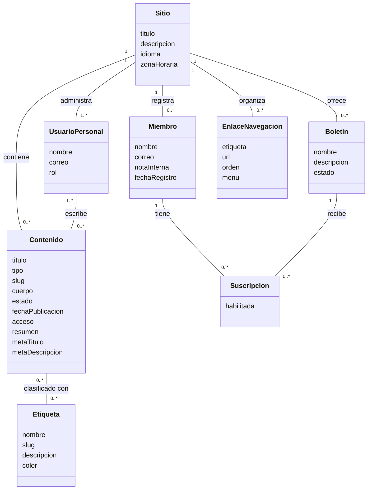

# Taller de pruebas exploratorias — Ghost 5.130.2

Fecha: 6 de noviembre de 2026. Entorno: Windows, Docker Desktop, imagen ghost:5.130.2, SQLite en modo development, tema Source v1.5.0. Aplicación en http://localhost:2368. Mailpit local configurado para correo transaccional. Navegador integrado de Codex (Chromium); no se realizó una matriz de navegadores.

## Alcance y método

Exploración de edición, publicación, páginas, etiquetas, miembros, menús, búsqueda y configuración. Se crearon datos ficticios y contenido de prueba. Las observaciones se verificaron mediante interacción con la interfaz, árbol de accesibilidad e inspección de atributos del DOM. No se ejecutaron pruebas con NVDA/JAWS ni una auditoría completa de conformidad WCAG.

Se registran 10 hallazgos localizados de accesibilidad. Varios comparten la causa de etiquetas no asociadas a controles; una revisión del profesor podría agruparlos en menos defectos. No equivalen a 10 fallos funcionales independientes. No se reportan como errores los casos que Ghost rechazó o normalizó correctamente.

## Tabla 1. Funcionalidades identificadas

| ID | Funcionalidad | Procedimiento y resultado observado |
|---|---|---|
| F01 | Acceso administrativo y verificación | El usuario completó el acceso en otro navegador mediante la configuración de correo local. Se verificó después el panel autenticado. |
| F02 | Crear y editar artículos | Posts > New post. Se introdujo título y contenido en el editor. |
| F03 | Guardar borradores automáticamente | Se observó Saving y después Draft - Saved; el registro obtuvo una URL de edición propia. |
| F04 | Publicar artículos | Publish > Continue, final review > Publish post, right now. Se confirmó Published y el enlace al artículo. |
| F05 | Previsualizar contenido | Preview abrió el panel con opciones Web, Email y enlace de vista previa. Se comprobó la apertura del panel, no la entrega de una newsletter. |
| F06 | Resumen personalizado | Post settings > Excerpt. Se guardó un resumen que apareció en la confirmación y en el listado público. |
| F07 | Metadatos SEO | Post settings > Meta data. Se introdujeron título y descripción SEO; no se comprobó indexación por buscadores. |
| F08 | Asociar etiquetas a artículos | Se creó/asignó Pruebas desde Post settings. El listado mostró el artículo clasificado bajo esa etiqueta. |
| F09 | Administrar etiquetas | Tags > New tag. Se creó una etiqueta, se guardaron descripción y color válido; nombre en blanco y color zzzzzz fueron rechazados. |
| F10 | Crear y publicar páginas | Pages > New page. Se publicó Acerca del taller. El slug reservado ghost fue normalizado a ghost-post. |
| F11 | Registrar miembros | Members > New member. Se guardó Miembro de prueba con dirección ficticia y apareció en el listado. Un correo mal formado fue rechazado. |
| F12 | Notas internas de miembros | Se guardó una nota identificada como no visible para el miembro. La nota seguía presente al volver a abrir su ficha. No se comprobó una sesión del miembro. |
| F13 | Configurar navegación | Settings > Navigation. Se añadió Taller apuntando a /ghost-post/ y se verificó el enlace en el sitio público. |
| F14 | Filtrar artículos por estado | Se abrió Published; aparecieron las publicaciones con ese estado. |
| F15 | Buscar contenido | Search site > bienvenida. La búsqueda devolvió el artículo de prueba. |

Evidencias visuales: [01-publicacion.png](https://github.com/DAREL767/prototipo/blob/evidencias-ghost/evidencias-ghost/01-publicacion.png), [02-miembro.png](https://github.com/DAREL767/prototipo/blob/evidencias-ghost/evidencias-ghost/02-miembro.png), [04-navegacion.png](https://github.com/DAREL767/prototipo/blob/evidencias-ghost/evidencias-ghost/04-navegacion.png), [06-ajustes-articulo.png](https://github.com/DAREL767/prototipo/blob/evidencias-ghost/evidencias-ghost/06-ajustes-articulo.png), [07-busqueda.png](https://github.com/DAREL767/prototipo/blob/evidencias-ghost/evidencias-ghost/07-busqueda.png) y [09-sitio-publico.png](https://github.com/DAREL767/prototipo/blob/evidencias-ghost/evidencias-ghost/09-sitio-publico.png).

## Tabla 2. Hallazgos de accesibilidad

Precondición común: sesión de administrador iniciada en la instalación descrita. Resultado esperado común: cada control debe tener un nombre accesible que comunique su propósito, además del rol y estado. El texto cercano en pantalla por sí solo no crea una asociación programática. Referencia: WCAG 2.2, criterio 4.1.2, https://www.w3.org/WAI/WCAG22/Understanding/name-role-value.html.

Severidad propuesta: media para todos estos hallazgos, por dificultar tareas con tecnologías de asistencia; debe ajustarse según la rúbrica. Estado: reproducido en inspección DOM/árbol de accesibilidad; pendiente validación con lector de pantalla real.

| ID | Título | Pasos | Resultado observado | Resultado esperado específico | Evidencia |
|---|---|---|---|---|---|
| D01 | Botón de Unsplash sin nombre accesible | Abrir un artículo; inspeccionar el botón del icono junto a Add feature image. | El botón gh-editor-feature-image-unsplash contiene solo un SVG sin texto alternativo; no tiene aria-label, aria-labelledby ni title. En el árbol aparece como botón sin nombre. | Nombre como Buscar imagen en Unsplash. | [05-editor-controles.json](https://github.com/DAREL767/prototipo/blob/evidencias-ghost/evidencias-ghost/05-editor-controles.json) |
| D02 | Campos de fecha y hora sin identificación accesible | Abrir un artículo > Settings > Publish date; inspeccionar ambos inputs. | La fecha solo tiene placeholder YYYY-MM-DD; la hora no tiene etiqueta asociada, aria-label ni aria-labelledby. El árbol muestra valores de fecha/hora sin propósito descriptivo. | Etiquetas Fecha de publicación y Hora de publicación asociadas a cada campo. | [06-ajustes-articulo.json](https://github.com/DAREL767/prototipo/blob/evidencias-ghost/evidencias-ghost/06-ajustes-articulo.json) y PNG |
| D03 | Búsquedas de etiquetas y autores sin etiqueta accesible | Artículo > Settings > Tags y Authors; inspeccionar los campos de búsqueda internos. | Ambos inputs de búsqueda carecen de label asociado y de atributos de nombre accesible; sus IDs son identificadores generados. | Identificar Buscar etiquetas y Buscar autores. | [06-ajustes-articulo.json](https://github.com/DAREL767/prototipo/blob/evidencias-ghost/evidencias-ghost/06-ajustes-articulo.json) |
| D04 | Selector Post access sin nombre accesible | Artículo > Settings > Post access; inspeccionar el select. | Hay texto Post access en pantalla, pero el select no tiene label asociado ni aria-label/aria-labelledby. El árbol muestra el valor Public sin identificar el propósito. | Asociar el texto Post access al selector. | [06-ajustes-articulo.json](https://github.com/DAREL767/prototipo/blob/evidencias-ghost/evidencias-ghost/06-ajustes-articulo.json) y PNG |
| D05 | Casilla Feature this post sin nombre accesible | Artículo > Settings; localizar Feature this post e inspeccionar el checkbox. | El checkbox no tiene id, etiqueta asociada ni atributos ARIA de nombre. El árbol expone una casilla sin nombre. | Nombre como Destacar este artículo. | [06-ajustes-articulo.json](https://github.com/DAREL767/prototipo/blob/evidencias-ghost/evidencias-ghost/06-ajustes-articulo.json) |
| D06 | Campo Labels de miembros sin nombre accesible | Members > abrir Miembro de prueba > Labels; inspeccionar el campo de búsqueda. | El input no tiene etiqueta asociada ni atributos de nombre accesible, pese a tener el texto Labels cerca. | Nombre como Buscar etiquetas del miembro. | [08-miembro-controles.json](https://github.com/DAREL767/prototipo/blob/evidencias-ghost/evidencias-ghost/08-miembro-controles.json) |
| D07 | Casilla de suscripción del miembro con etiqueta vacía | Members > abrir Miembro de prueba > Newsletters; inspeccionar la casilla del boletín. | Tiene un label asociado, pero su contenido es solo espacios y no dispone de nombre ARIA. No comunica el nombre del boletín. | Nombre como Suscribir al boletín Taller Ghost. | [08-miembro-controles.json](https://github.com/DAREL767/prototipo/blob/evidencias-ghost/evidencias-ghost/08-miembro-controles.json) |
| D08 | Botones de papelera del menú sin nombre accesible | Settings > Navigation > Customize; inspeccionar las papeleras de Home, About y Taller. No es necesario eliminarlos. | Botones formados por SVG de papelera y span vacío; no tienen title, aria-label ni aria-labelledby. El árbol muestra botones sin nombre. | Nombres como Eliminar enlace Home, diferenciando cada fila. | [04-navegacion-controles.json](https://github.com/DAREL767/prototipo/blob/evidencias-ghost/evidencias-ghost/04-navegacion-controles.json) y PNG |
| D09 | Interruptor de verificación de acceso sin nombre accesible | Settings > Staff > Security settings; inspeccionar el switch sin cambiarlo. | Expone role=switch y aria-checked, pero no nombre accesible: no tiene texto, label asociado, title ni nombre ARIA. | Nombre como Exigir códigos 2FA en todos los accesos del personal. | [03-ajustes-controles.json](https://github.com/DAREL767/prototipo/blob/evidencias-ghost/evidencias-ghost/03-ajustes-controles.json) |
| D10 | Interruptor de newsletters sin nombre accesible | Settings > Email newsletter > Newsletter sending; inspeccionar el switch sin cambiarlo. | Expone rol y estado, pero no tiene nombre accesible; el texto del apartado no está asociado al botón. | Nombre como Habilitar envío de newsletters. | [03-ajustes-controles.json](https://github.com/DAREL767/prototipo/blob/evidencias-ghost/evidencias-ghost/03-ajustes-controles.json) |

La solución general consiste en asociar etiquetas visibles mediante label/for o aria-labelledby; en botones de iconos, añadir texto accesible o aria-label. Se debe verificar después el árbol de accesibilidad y el comportamiento con un lector de pantalla. No se modificó el código de Ghost para corregir los hallazgos.

## Pruebas con comportamiento correcto

- Una etiqueta con nombre formado solo por espacios mostró You must specify a name for the tag.
- El color zzzzzz mostró The colour should be in valid hex format; 227755 sí se guardó.
- El correo correo-invalido mostró Invalid Email; la dirección ficticia válida sí se guardó.
- La ruta reservada ghost se normalizó a ghost-post y la página se publicó.
- Una nueva fila de navegación con etiqueta formada solo por espacios no quedó en el menú público.
- El artículo publicado apareció en búsqueda y en el filtro Published.

## Incidencia del entorno

Failed to send email apareció durante el acceso desde otro navegador sin SMTP configurado. Se añadió Mailpit y el usuario completó el acceso. Se clasifica como incidencia de configuración, no como defecto confirmado del CMS. Mailpit recibe correo transaccional de prueba; no sustituye la configuración de Mailgun requerida para newsletters masivas.

## Diagrama de dominio conceptual

Inferido de las pantallas exploradas; no representa una extracción del esquema real de la base de datos. Se incluyen atributos y relaciones, sin métodos. Contenido representa artículos y páginas mediante el atributo tipo. Suscripcion modela la relación entre miembros y boletines.

## Evidencias y pendiente del entregable

Las capturas y los archivos JSON se publicaron en el repositorio público DAREL767/prototipo, rama evidencias-ghost. Índice: https://github.com/DAREL767/prototipo/blob/evidencias-ghost/evidencias-ghost/README.md. Los enlaces de las tablas apuntan a esas evidencias públicas. La aplicación Ghost continúa siendo local: localhost no es una URL de evidencia pública.

Las capturas prueban el contexto visual. Los JSON conservan los atributos observados que sustentan los hallazgos de accesibilidad; una captura sola no demuestra la ausencia de un nombre programático. Los TXT incrementales del árbol no se incluyeron en la publicación; los JSON contienen los atributos que sustentan los hallazgos.
